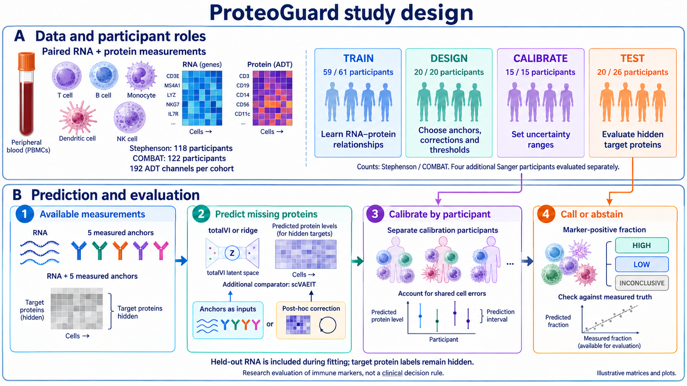
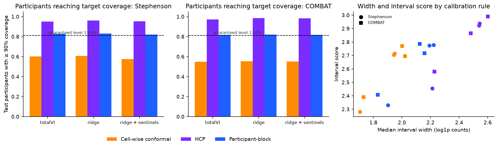
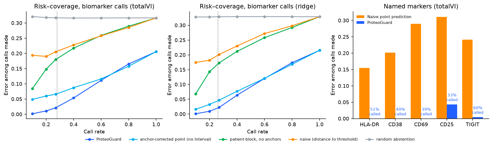

# ProteoGuard

Small protein panels for reliable immune marker inference

Anel Umirbaeva and Nazira Dunbayeva
Equal overall contributions
Final project report   11 October 2026

## 1 Problem definition

Can RNA plus a small measured surface-protein panel support reliable participant-level calls of immune activation markers when most proteins were not measured? ProteoGuard tests this question using existing predictors, participant-level uncertainty calibration and selective high or low marker calls. Its therapeutic-discovery relevance is the reliability of immune phenotyping and candidate biomarker measurements. The experiments do not establish treatment efficacy or a clinical diagnostic rule.

CITE-seq measures RNA and antibody-derived tags (ADTs) in the same cells. RNA reports gene activity, while surface proteins help characterize immune-cell identities and states. Imputation estimates unmeasured proteins, but a useful estimate must also communicate when a participant-level interpretation remains uncertain. Here the target is log(1 + observed ADT count), which includes measurement variation as well as biology.

The results support two specific findings: measured proteins improved ridge prediction in both studied cohorts, and participant-block calibration improved the chosen reliability measure. Post-hoc correction was cohort-dependent. COMBAT supported substantially fewer biomarker calls, despite acceptable calibrated coverage.

## 2 Major challenges and existing limitations

The field faces imperfect RNA–protein correspondence, sparse RNA measurements, antibody background, staining and sequencing-depth variation, partially overlapping panels, and rare cell states with few examples. Across studies, donor composition, disease context and processing conditions can change. Removing batch effects can also remove biological variation. Measurement cost, reference-data availability and computational demands constrain deployment [1–4].

Existing methods already address substantial parts of this problem. totalVI jointly models RNA and protein counts, background and missing proteins [1]. sciPENN predicts proteins and quantifies uncertainty [2]. scVAEIT supports incomplete multimodal panels [3]. dsb models technical noise in measured ADTs [4]. Hierarchical conformal methods address grouped observations [5]. Our selected challenges are participant-level reliability and the value of a small measured panel, rather than all sources of missing biological information.

## 3 Proposed method and study design

Figure 1. ProteoGuard study design. Illustrations and matrices are conceptual. Participant counts are Stephenson / COMBAT. The four Sanger evaluation participants are additional to the 20-person Stephenson test allocation.

| Cohort | Participants | Cells | Processing |
| --- | --- | --- | --- |
| Stephenson [6] | 118 | 115,708 | 3 sites |
| COMBAT [7] | 122 | 118,649 | 2 institutes; 10 pools |

Both analyses contain 192 ADT channels before target exclusions. The pipeline excludes LPS-stimulated Stephenson samples and low-density-neutrophil preparations in COMBAT, and caps each participant at 1,000 cells. Within each split, different people provide protein labels for training, design, calibration and testing. Design participants select anchors, fit corrections and set thresholds. Calibration participants adjust intervals after these choices are fixed. Test target proteins remain concealed until evaluation.

Stephenson allocates 59 training and 20 design participants, then repeatedly divides a 35-person pool into 15 calibration and 20 test participants. Four Sanger participants receive a separate evaluation without local calibration participants. COMBAT allocates 61 training and 20 design participants, then divides 41 into 15 calibration and 26 test participants. Two train/held-out splits per cohort reuse people; they are repeated evaluations, not independent replications.

Input visibility is transductive: held-out RNA enters totalVI fitting and the ridge RNA SVD basis while target protein labels remain hidden. The scVAEIT comparison also exposes its allowed five anchors. This evaluates imputation in an integrated cohort, rather than a frozen predictor applied to entirely unseen participant RNA. Full measurements remain necessary in reference, design and calibration participants.

## Predictors calibration and marker decisions

### Predictors and measured anchors

totalVI compresses each cell into a shared latent representation and learns RNA and protein count distributions, including a protein background component [1]. Protein intervals use likelihood-consistent posterior-predictive sampling, including the learned efficiency term in the reported scvi-tools 1.4.2 implementation. The manuscript describes 100 draws and the 5th and 95th percentiles. These target observed ADT counts rather than background-free expression. Ridge predicts log1p ADT from RNA components and starts with residual-based intervals. Its historical in-sample residual quantiles may understate out-of-sample errors.

We compare small measured panels in two ways. A correction uses each participant’s median anchor residuals to adjust other proteins. Controls include a common offset, a protein-specific shared map, a multi-anchor ridge map and an isotype-driven map. The alternative measured-input ridge appends anchor values and participant summaries to RNA features. A design-mean reference already includes an average correction and must not be labelled fully uncorrected. Decision markers are excluded from anchor selection. Matched evaluations use the same 177–179 target proteins after excluding the relevant anchors and isotypes.

### Participant calibration and its scope

For initial interval [l, u], correction s and observed log1p count y, the cell score is max(l + s − y, y − u − s). Each participant contributes an upper quantile of its cell scores. The implementation uses NumPy method="higher", giving one-based order ceil(0.90 × (m − 1)) + 1 for m cells. This matches the implementation and can be one order statistic more conservative than ceil(0.90 × m).

Across n calibration participants, choose order k = ceil((n + 1) × 0.80). At n = 15, k = 13. Under exchangeability of complete participant scores and an appropriately fixed or symmetric pipeline, the rank argument gives, separately for each protein, P(new participant’s empirical cell coverage ≥ 90%) ≥ 13/16 = 81.25%. This is marginal over participant sampling, not a guarantee for every person, the whole panel or an unfamiliar site. Transductive calibration/test symmetry requires justification. A new participant arriving after fitting is a different deployment setting.

Pooled cell-wise conformal and hierarchical conformal prediction (HCP) are comparators. HCP targets marginal coverage of an observation from a new group, a different quantity. Wider intervals and higher participant success do not establish that HCP failed. Historical code needs edge-case checks before changing calibration sizes, including an infinite quantile when k > n; the reported n = 15 setting does not reach that edge case.

### Biological decision rule

A mixture fitted to design measurements defines cell positivity for eligible proteins and cell types. The participant readout is the fraction of positive cells, compared with a design-cohort median. A calibrated fraction interval entirely above or below that threshold permits a high or low call; otherwise the procedure abstains. Selective error among calls is an empirical endpoint, not a consequence automatically guaranteed by cell-level interval coverage. Thresholds are cohort-relative, not clinical.

## 4 Technical rationale and 5 Main results

The anchor rationale is that participant errors share a low-dimensional component. In Stephenson, PC1 explained 75.6% of participant-offset variance against a 9.8% permutation reference, with 98.4% of loadings sharing a sign. Its ADT-depth association was ρ = 0.83. COMBAT showed a weaker component, explaining 38–40%, associated with depth and processing pool. These observations support a technical contribution but do not prove a purely technical cause or exclude biology.

Participant calibration addresses a separate issue: cells from one person share errors, so increasing cell counts does not create more independent participants. Our contribution is the combined evaluation of measured panels, correction controls and participant-level decisions. Protein imputation, technical correction and grouped conformal prediction already have prior art [1–5].

Figure 2. Supplied comparison of calibration rules and interval efficiency. The dashed 13/16 bound assumes exchangeability and appropriate fitting symmetry. HCP targets a different marginal quantity.

| Matched comparison | Stephenson | COMBAT |
| --- | --- | --- |
| Ridge RMSE: RNA only to measured inputs | 0.72 to 0.54 | 0.64 to 0.55 |
| Participant success: cell-wise to participant calibration | 58% to 82% | 55% to 82% |

RMSE is prediction error on the log1p count scale. Participant success is the share reaching at least 90% empirical cell coverage, assessed per protein and summarized. The accuracy comparison adds measured inputs. The reliability comparison changes calibration on the same measured-input ridge predictions. These are separate interventions. Displayed summaries do not supply confidence intervals or establish universal benefit.

The learned shared map offered little over simple controls in Stephenson: interval scores were 2.77 for the map, 2.79 for a common offset and 2.81 for the isotype-driven map. Measured-input ridge reached 2.33 with similar coverage. In COMBAT, measured-input ridge improved interval score from 2.81 to 2.41 and width from 2.15 to 1.83. Post-hoc totalVI correction was inconsistent, with undercoverage rising from 2.1% to approximately 4.0–5.4% across reported corrections.

## Biomarker usefulness and the completed comparator

Figure 3. Original risk–coverage curves and named-marker summaries. Compare methods at the same call rate. The named-marker bars use different call rates; zero observed errors do not establish zero population risk.

At a matched 27% call rate in Stephenson, observed error was 31.7–32.9% with random abstention, 20.1–20.6% with threshold-distance selection, 4.7–6.6% after anchor correction, and 2.1–2.2% with ProteoGuard. These ranges span the two base predictors, not confidence intervals. Anchor correction contributed much of this improvement. The full correction-and-calibration procedure further reduced observed error in this comparison.

COMBAT supported only 5–9% of decisions at 5–9% observed error. Frequent abstention limits overconfident interpretation but also restricts practical usefulness. The current evidence does not show broad recovery of participant biomarker calls across both cohorts. Marker-level call counts and participant-level uncertainty are needed before emphasizing small or zero error rates.

### Completed scVAEIT comparison

| Stephenson predictor | RMSE | Participant success | Calls | Call error |
| --- | --- | --- | --- | --- |
| Ridge with five anchors | 0.54 | 82% | 35% | 1.6% |
| scVAEIT with five anchors | 0.80–0.92 | 82–83% | 23% | 3.0% |

The updated supplied report describes 200 epochs per split, near a loss plateau, replacing its stale 100-epoch and ongoing 300-epoch passages. scVAEIT did not outperform measured-input ridge in these reported runs, despite similar calibrated coverage. Calls and errors in this table are each method’s own operating point, not a matched-call-rate architecture comparison. Raw training logs and prediction-level exports were not supplied locally, so this revision records reported completion rather than independently verifying convergence or reproducing these numbers.

## Critical evaluation of the hypotheses

| Hypothesis or claim | Assessment | Evidence |
| --- | --- | --- |
| Measured panels improve prediction | Supported here | Ridge RMSE improved in both cohorts |
| Participant calibration improves reliability | Supported here | Participant success improved across reported predictors |
| Learned correction helps universally | Not supported | Simple controls nearly matched it; COMBAT inconsistent |
| Inference enables useful marker calls | Conditional | Stephenson stronger; COMBAT mostly inconclusive |

The initial project emphasized learning a correction and selecting anchors. The control experiments weakened claims that these complex components were essential. The refined hypothesis is that measured panels can improve informativeness at comparable participant reliability. Evidence is strongest for direct measured inputs to ridge and for participant calibration. It does not establish that all totalVI corrections improve or that every observed benefit was prospectively specified.

### Remaining limits

Both cohorts are COVID-era blood studies. Random participant splits largely evaluate represented processing environments. Shared processing pools can limit exchangeability, and the four Sanger participants do not establish a general requirement for site-specific calibration. Testing a new pool, new disease context or fully unseen RNA requires a separate protocol.

Repeated calibration/test allocations and overlapping train/held-out splits reuse participants. They do not increase the number of independent biological units. Reported bootstrap uncertainty should operate at the participant level after appropriate aggregation. Some summaries here lack their underlying denominators and intervals. Coverage conclusions also depend on the exact target list and the distinction between observed ADT counts and denoised expression.

Association with depth or processing pool does not establish the causal source of errors. Negative adjusted severity associations cannot prove the absence of biological information. A cell-type-balanced sensitivity and preservation of measured within-cell-type marker differences are especially important when interpreting shared corrections.

The small-panel result concerns shared errors and selected surface markers. It does not establish reconstruction of an entire proteome. Isotype controls can be useful where they already exist, but their availability and assay cost are not universal. More complex imputers may require different tuning; the scVAEIT result applies to the reported configuration.

## 6 Scientific insights and individual contributions

Prediction information and uncertainty reliability are distinct. A calibrated method can give acceptable coverage while remaining too uncertain to support many decisions, as COMBAT illustrates. Calibration cannot create biological signal that the measured inputs lack.

A small measured panel can supply participant context without covering every protein’s biology. Simple correction controls explain much of the benefit in Stephenson, while direct measured inputs improved ridge prediction in both cohorts. This suggests that evaluating how measurements enter the predictor is at least as important as designing a more elaborate correction afterward.

The supported conclusion is that small panels improved prediction and participant calibration clarified which immune-marker inferences remained uncertain in the studied settings. The results support specific hypotheses rather than proving universal superiority over totalVI. For biomarker research, an explicit inconclusive result can be informative, but useful-call yield must accompany any claim about reliability.

Future experiments should freeze thresholds and panels, evaluate measured marker-positive fractions within cell types, and test a processing pool excluded from development. A biological case study can assess whether correction preserves participant differences in CD38 or HLA-DR. These are proposed analyses, not completed findings.

### Equal overall contributions

Anel Umirbaeva and Nazira Dunbayeva contributed equally overall (50% each), as specified by the team. The detailed role allocation below is proposed for author confirmation before submission.

| Component | Anel Umirbaeva | Nazira Dunbayeva |
| --- | --- | --- |
| Problem | Biological motivation and marker question | Reliability question and hypotheses |
| Literature | Measurement noise and cohort biology | Imputation and uncertainty methods |
| Code and methods | Data preparation and baseline experiments | Anchor, calibration and evaluation code |
| Rationale | Shared-error analysis and correction controls | Participant scores and assumptions |
| Evaluation | Accuracy and cohort comparisons | Coverage and selective marker calls |
| Insights | Biological interpretation and figures | Limitations and reproducible reporting |

## Reproducibility and references

Code and deliverables: https://github.com/nazirad19/proteoguard. This documentation revision does not retrain models or rescore cohort predictions. Numerical values and original scientific plots come from the supplied report and figures. The study-design artwork is an AI-generated conceptual illustration checked against the reported allocations; its heatmaps and example plots are not measured results.

The repository includes the analysis scripts, configuration fixes, an ordered runner and lightweight CPU tests. The supplied archive lacked cohort matrices, saved predictions, exact exported participant/protein manifests and full result CSVs. Their absence locally does not show they are absent on the research server. Fresh-clone end-to-end reproduction remains unverified. The reproducibility document records preparation, environment, provenance and quantile edge cases that still require verification.

The runtime specification targets Python 3.11 and scvi-tools 1.4.2, but it is not the original server environment lock. Record package versions, GPU metadata, fit seeds, participant/target identifiers and input/output checksums. For scVAEIT, archive each completed run’s configuration, logs and prediction checksum: its script can skip existing prediction files, so changing an epoch setting alone does not establish a new fit. Retain separate environments where required.

Figures 2 and 3 reuse supplied results rather than regenerating them from raw outputs. README links identify the current course report and slides. Detailed historical execution fixes remain in docs/REPRODUCIBILITY.md. No claim of full numerical reproduction is added by this documentation update.

[1] Gayoso et al. Joint probabilistic modeling of single-cell multi-omic data with totalVI. Nature Methods (2021). https://doi.org/10.1038/s41592-020-01050-x

[2] Lakkis et al. A multi-use deep learning method for CITE-seq and single-cell RNA-seq data integration with cell surface protein prediction and imputation. Nature Machine Intelligence (2022). https://doi.org/10.1038/s42256-022-00545-w

[3] Du et al. Robust probabilistic modeling for single-cell multimodal mosaic integration and imputation via scVAEIT. PNAS (2022). https://doi.org/10.1073/pnas.2214414119

[4] Mulè et al. Normalizing and denoising protein expression data from droplet-based single cell profiling. Nature Communications (2022). https://doi.org/10.1038/s41467-022-29356-8

[5] Lee, Barber and Willett. Distribution-free inference with hierarchical data. https://arxiv.org/abs/2306.06342

[6] Stephenson et al. Single-cell multi-omics analysis of the immune response in COVID-19. Nature Medicine (2021). https://doi.org/10.1038/s41591-021-01329-2

[7] COMBAT Consortium. A blood atlas of COVID-19 defines hallmarks of disease severity and specificity. Cell (2022). Data: https://doi.org/10.5281/zenodo.6120249
